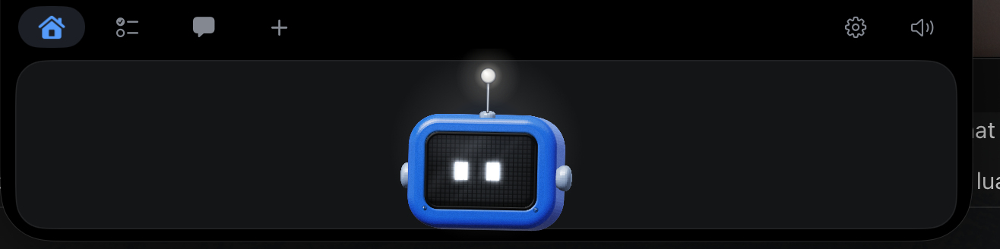
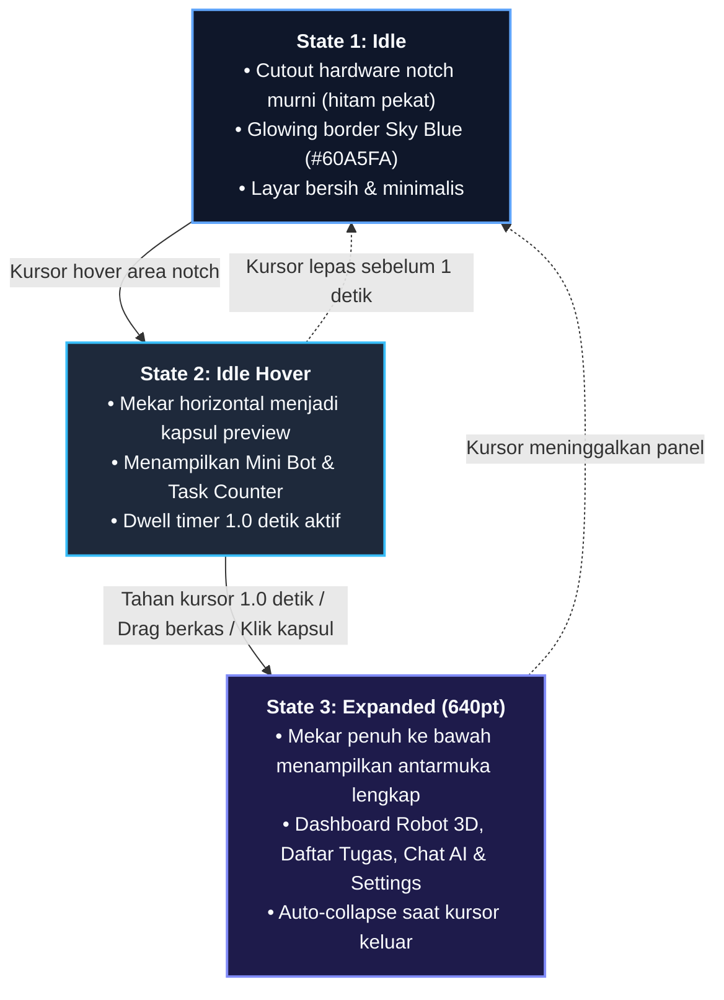
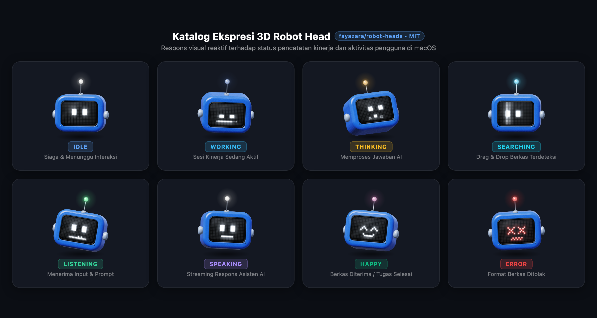

<h1 align="center">NilaiKinerja</h1>

<p align="center">
  <strong>Aplikasi pencatatan kinerja harian ASN berbasis hardware notch MacBook dengan maskot 3D interaktif dan Asisten AI lokal.</strong>
</p>

<p align="center">
  <a href="https://github.com/dendyadinirwana/nilaikinerja/releases/latest"></a>
  <a href="https://www.apple.com/macos/"></a>
  <a href="https://apple.com/mac/"></a>
  <a href="https://swift.org/"></a>
  <a href="LICENSE"></a>
</p>

<p align="center">
  
</p>

---

## 🌟 Ikhtisar

**NilaiKinerja** adalah utilitas desktop macOS modern yang menyatu mulus ke dalam hardware notch MacBook. Dirancang untuk membantu aparatur sipil negara (ASN) maupun profesional mencatat kegiatan harian secara efisien, melampirkan berkas bukti dukung secara instan, dan berkonsultasi dengan Asisten AI lokal — tanpa mengganggu alur kerja utama di layar.

---

## ✨ Fitur Unggulan

### 1. 🎛️ Interaksi 3-State Notch
Antarmuka notch beradaptasi secara cerdas dalam 3 tahap interaksi cairan (*liquid spring transitions*):



---

### 2. 🤖 Maskot 3D Robot Head Reaktif

Didukung oleh engine grafis TV-headed 3D bot dari [`fayazara/robot-heads`](https://github.com/fayazara/robot-heads) (lisensi penuh MIT):

<p align="center">
  
</p>

- **Cursor Aware Tracking:** Kepala 3D dan pupil mata LED robot menoleh mengikuti kursor mouse secara *real-time* (40 FPS throttled) dengan simulasi pegas elastis.
- **Interaksi Klik Responsif:** Klik robot pada panggung beranda untuk melihat animasi lompat putar 360 derajat (*hop with spin*) dengan senyum ceria `^ ^`.
- **Ragam Ekspresi Kontekstual:**
  - `idle`: Mata santai melirik dan berkedip, antena putih lembut.
  - `working`: Mata fokus menatap ke bawah dengan animasi progress bar LED.
  - `thinking`: Kepala menengadah dengan titik loading berdenyut, antena kuning/amber (aktif saat AI menyusun respons).
  - `searching`: Sinar pemindai cyan menyapu layar bolak-balik (aktif saat file melayang di atas notch).
  - `happy`: Mata tersenyum `^ ^` dengan mulut pixel melengkung (aktif saat tugas berhasil disimpan).
  - `error`: Mata merah `X X` dengan gelombang peringatan (aktif saat validasi gagal).
  - `speaking`: Mulut pixel bergerak naik turun berbicara (aktif saat streaming jawaban AI).
  - `sleeping`: Mata terpejam dengan huruf `Z Z` melayang (aktif di luar jam kerja).

---

### 3. 📂 Smart File Drag & Drop
Tarik berkas apa pun (PDF laporan, foto dokumentasi `.png`/`.jpg`, Word, Excel) langsung ke notch:
- Notch otomatis langsung mekar ke mode Expanded seketika (tanpa jeda).
- Form **Tambah Kegiatan** otomatis terisi:
  - Judul kegiatan dibersihkan otomatis dari nama berkas (contoh: `Draf_Laporan_SIPPDT_2026.pdf` ➔ `Draf Laporan SIPPDT 2026`).
  - Waktu default otomatis diatur 1 jam ke depan.
  - Berkas otomatis terlampir sebagai bukti kinerja yang aman.
- Robot merayakan berkas yang diterima dengan animasi gembira.

---

### 4. 🧠 Asisten AI Lokal (OpenAI-Compatible)
- Terintegrasi langsung di dalam notch (`Cmd + 3`).
- **Model Selector Dropdown:** Berganti model AI secara cepat di bawah kolom input chat.
- **Kompatibilitas Universal:** Bekerja dengan server lokal maupun remote (9router, Ollama, LM Studio, Groq, vLLM, OpenRouter, dan OpenAI).
- Dilengkapi indikator pemikiran model (*thinking disclosure*) dan tombol **"Catat ke Kinerja"** sekali klik.

---

### 5. ⚙️ Halaman Pengaturan Kontekstual & OTA Update
Terbagi rapi dalam 4 tab dengan animasi sliding pill tanpa border stroke yang mengganggu:
- **Notch & Interaksi:** Pengaturan toggle glow, intensitas cahaya (20%–100%), dwell timer (0.3s–2.0s), ukuran kapsul, lebar panel, dan auto-collapse delay.
- **Asisten AI:** Konfigurasi endpoint Base URL, API Key opsional, dan tombol refresh daftar model.
- **Kinerja & Berkas:** Jam kerja ASN, hari kerja aktif, pengingat checkpoint berkala (15m–90m), suara notifikasi, dan pemilih folder penyimpanan lampiran.
- **Tentang:** Status versi, lisensi MIT, tautan repository, tombol **"Periksa Pembaruan"** (*Check for Updates*), dan toggle **Pembaruan Otomatis**.

---

## ⌨️ Pintasan Keyboard (Shortcuts)

Saat panel sedang terbuka:

| Pintasan | Aksi |
|---|---|
| `Cmd + 1` | Buka Layar Utama (Beranda & Maskot Robot) |
| `Cmd + 2` | Buka Daftar Kegiatan Hari Ini |
| `Cmd + 3` | Buka Asisten AI |
| `Cmd + 4` | Buka Formulir Tambah Kegiatan Cepat |
| `Tab` / `Shift + Tab` | Pindah tab menu ke kanan / ke kiri |
| `←` / `→` | Navigasi layar |
| `Esc` | Menutup panel kembali ke notch idle |

---

## 🚀 Instalasi & Cara Pakai

### Opsi 1: Unduh Rilis Binary (Direkomendasikan)
1. Unduh rilis terbaru `NilaiKinerja.zip` dari [GitHub Releases](https://github.com/dendyadinirwana/nilaikinerja/releases/latest).
2. Ekstrak file zip dan pindahkan **`NilaiKinerja.app`** ke folder **/Applications** (Aplikasi).
3. Buka **Terminal** dan jalankan perintah ini sekali untuk melepas tanda karantina macOS:
   ```bash
   xattr -cr /Applications/NilaiKinerja.app
   ```
4. Buka aplikasi via Spotlight (`Cmd + Space` ketik `Nilai Kinerja`) atau:
   ```bash
   open /Applications/NilaiKinerja.app
   ```

### Opsi 2: Kompilasi Mandiri dari Source Code
Aplikasi dapat di-build langsung tanpa membuka Xcode IDE:

```bash
# Clone repository
git clone https://github.com/dendyadinirwana/nilaikinerja.git
cd nilaikinerja

# Kompilasi versi release & uji otomatis (185 checks)
./build.sh release
./dist/NilaiKinerja.app/Contents/MacOS/NilaiKinerja --selftest

# Pasang ke folder /Applications
rm -rf /Applications/NilaiKinerja.app
cp -R dist/NilaiKinerja.app /Applications/NilaiKinerja.app
codesign --force --deep --sign - /Applications/NilaiKinerja.app
touch /Applications/NilaiKinerja.app

# Jalankan aplikasi
open /Applications/NilaiKinerja.app
```

---

## 🔒 Izin Akses macOS (Wajib)

Agar aplikasi dapat mendeteksi kursor kursor saat melintasi notch dan menerima gesture drag-and-drop dari Finder:
1. Buka **System Settings** (Pengaturan Sistem) ➔ **Privacy & Security** (Privasi & Keamanan).
2. Pilih menu **Accessibility** (Aksesibilitas).
3. Aktifkan sakelar untuk **Nilai Kinerja**.  
   *(Jika belum ada di daftar, klik tombol `+` lalu pilih `NilaiKinerja.app` dari folder `/Applications`).*

---

## 🛠️ Arsitektur & Teknologi

- **Bahasa:** Swift 5.9+ (SwiftUI & AppKit native).
- **Notch Engine:** Kustom `NSPanel` di level `.statusBar` dengan canvas morphing berbasis spring physics tanpa kedip.
- **Karakter 3D:** Engine Canvas 2D murni (`robot-heads-vanilla.js`) berukuran 33 KB, dihosting secara ringan via `WKWebView` non-blocking.
- **Database:** SQLite native lokal (`sqlite3`) dengan migrasi otomatis.
- **Ekspor Dokumen:** Generator format laporan resmi Microsoft Word (`.docx`) native tanpa library pihak ketiga.
- **Pengujian:** Headless test suite mandiri (`--selftest` & `--selftest-ai`) dengan 185 pengujian terverifikasi.

---

## 📄 Lisensi & Hak Cipta

Proyek ini dilisensikan di bawah **[MIT License](LICENSE)**.

- **NilaiKinerja:** Hak Cipta © 2026 nirwna.
- **3D Robot Heads Mascot:** Hak Cipta © 2026 Fayaz Ahmed ([`fayazara/robot-heads`](https://github.com/fayazara/robot-heads)).

Bebas digunakan, dimodifikasi, dan didistribusikan secara komersial maupun non-komersial.
